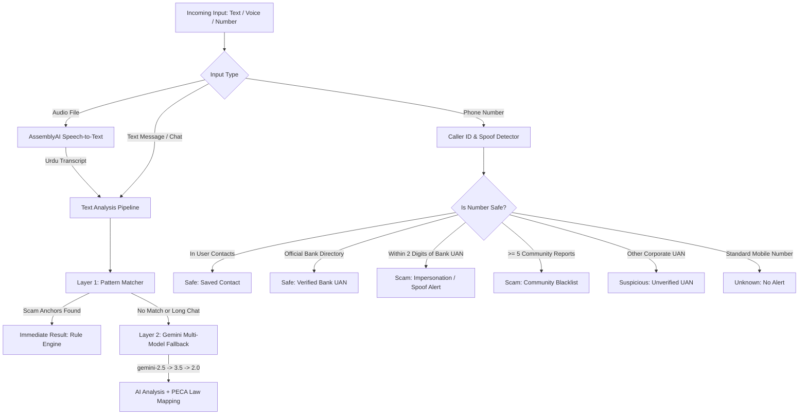

# 🛡️ FraudGuard PK — Fraud & Scam Detector

An end-to-end, Pakistan-specific cybercrime and financial scam detection ecosystem. It protects citizens from online fraud, SMS phishing, impersonation calls, fake bank warnings, and voice note scams across **Web**, **Chrome Extension**, and **Android Mobile**.

---

## 📋 Table of Contents
1. [What is FraudGuard PK?](#-what-is-fraudguard-pk)
2. [Project Architecture Overview](#-project-architecture-overview)
3. [Technology Stack](#-technology-stack)
4. [Component-by-Component Breakdown](#-component-by-component-breakdown)
   - [1. Backend API (`/backend`)](#1-backend-api-backend)
   - [2. Web App & Chrome Extension (`/frontend`)](#2-web-app--chrome-extension-frontend)
   - [3. Mobile Application (`/FraudGuardExpo`)](#3-mobile-application-fraudguardexpo)
5. [How Fraud Detection Works (Under the Hood)](#-how-fraud-detection-works-under-the-hood)
6. [What Remains Behind (Current Gaps & Incomplete Areas)](#-what-remains-behind-current-gaps--incomplete-areas)
7. [Recommended Features for the Future](#-recommended-features-for-the-future)
8. [Setup & Running Instructions](#-setup--running-instructions)

---

## 🎯 What is FraudGuard PK?

Online fraud and social engineering scams in Pakistan are rampant—scammers impersonate banks (**HBL, UBL, Meezan, Bank Alfalah**), mobile wallets (**JazzCash, EasyPaisa**), government programs (**BISP / Ehsaas**), and authorities (**FIA, PTA, NADRA**). They operate heavily in **Roman Urdu**, **Urdu**, and **English**.

**FraudGuard PK** tackles this with a multi-layered defense:
- **Instant Pattern Matching**: Detects common Pakistani scams offline with zero API latency.
- **AI-Powered Deep Inspection**: Employs Google Gemini with cybercrime prompts tailored to Pakistani fraud tactics.
- **PECA 2016 Legal Mapping**: Maps detected crimes directly to sections of the **Prevention of Electronic Crimes Act 2016** (PECA) and drafts an official **FIA Cyber Crime Wing complaint letter**.
- **Voice Note Transcription**: Converts Urdu voice messages into text via AssemblyAI and screens them for fraud.
- **Smart Caller ID & Spoof Detector**: Catches lookalike numbers mimicking official bank UANs (e.g., using Levenshtein distance matching).
- **Consensus-Based Community Reporting**: Allows users to flag scam numbers, requiring 5 independent reporters before flagging publicly.
- **Background Android Call & Notification Protection**: Catches scam calls and suspicious WhatsApp/SMS messages on Android devices in real time.

---

## 🏗️ Project Architecture Overview

```
fraud-detector/
│
├── backend/                  # Python Flask REST API
│   ├── main.py               # API endpoints, caller ID, number screening & reporting
│   ├── fraud_detector.py     # 2-layer engine: Rule Engine + Google Gemini fallback
│   ├── pattern_matcher.py    # Layer 1: Zero-cost regex and keyword scam detection
│   ├── audio_handler.py      # AssemblyAI speech-to-text (Urdu) integration
│   ├── data/                 # JSON databases (official bank UANs, scam patterns, reports)
│   └── tests/                # Automated test suites for detection rules
│
├── frontend/                 # React 19 + Vite + Tailwind CSS v4
│   ├── src/pages/Analyzer.jsx# Web analyzer (text, text file, audio voice notes)
│   ├── src/components/       # Result cards, dropzone file upload, complaint generator
│   ├── src/content.js        # Chrome Extension content script (WhatsApp/X/LinkedIn)
│   ├── src/background.js     # Chrome Extension service worker
│   └── manifest.json         # Manifest V3 configuration for Chrome Extension
│
└── FraudGuardExpo/           # React Native / Expo SDK 54 Android App
    ├── app/                  # Expo Router file-based screens (Analyzer, Alerts, History)
    ├── src/screens/          # Analyzer screen with live phone number checker
    ├── src/services/         # API clients, caller ID, contact checks, and FIA links
    └── modules/expo-call-guard/ # Custom Kotlin Android module for call & notification interception
```

---

## 🛠️ Technology Stack

| Layer | Technologies Used | Purpose |
|---|---|---|
| **Backend** | Python 3, Flask, Werkzeug, Flask-CORS, Gunicorn | Lightweight REST API server |
| **AI & NLP** | Google GenAI SDK (`gemini-2.5-flash`, `gemini-3.5-flash`, `gemini-2.0-flash`) | Contextual reasoning in Roman Urdu/Urdu/English |
| **Speech-to-Text**| AssemblyAI (`language_code="ur"`) | Transcribing Pakistani Urdu voice notes |
| **Web Frontend**| React 19, Vite, Tailwind CSS v4, Framer Motion, Lucide Icons | Responsive modern web UI |
| **Browser Ext.** | Chrome Extensions Manifest V3, `@crxjs/vite-plugin` | In-browser chat protection on WhatsApp Web |
| **Mobile App** | React Native 0.81, Expo SDK 54, Expo Router v6, TypeScript | Universal cross-platform mobile app |
| **Native Android**| Kotlin, Android `TelephonyManager`, `NotificationListenerService` | Background incoming call & message interception |

---

## 🔍 Component-by-Component Breakdown

### 1. Backend API (`/backend`)
The backend operates as the central intelligence engine:
- **`main.py`**:
  - `/analyze/text`: Accepts text or chat extracts, checks rule patterns first, then queries Gemini.
  - `/analyze/audio`: Accepts audio files (up to 25MB), transcribes via AssemblyAI, then analyzes.
  - `/check-number`: Evaluates phone numbers against 4 reputation tiers: `safe` (verified bank/saved contact), `scam` (community confirmed or spoofed bank UAN), `suspicious` (unverified UAN), or `unknown` (regular mobile numbers).
  - `/report-number`: Rate-limited community reporting requiring a threshold of 5 distinct hashed IP addresses and 180-day decay.
  - `/unreport-number`: Appeal/removal mechanism to unblock erroneously reported numbers.
  - `/number-lists`: Exports synced whitelists and spoofable variants to the mobile app for offline on-device screening.
  - These unversioned routes are the **legacy API** (no token). They stay only until the mobile app moves to `/v1`.
- **`api_v1.py`** — the token-protected `/v1` API (database-backed):
  - `POST /v1/auth/anonymous`: The app calls this on first launch and receives its own token. No login screen.
  - `POST /v1/auth/refresh`, `GET /v1/account`, `DELETE /v1/account`: Renew the token, read account state, delete the account and its data.
  - `POST /v1/auth/email/start` and `/v1/auth/email/verify`: 6-digit email code (10-minute expiry, 5 attempts). Needed only to report a number.
  - `POST /v1/analyze/text`, `POST /v1/analyze/audio`: Same analysis as before, with per-user and per-network daily limits.
  - `POST /v1/check-number`, `GET /v1/number-lists`: Same screening rules as the legacy routes.
  - `POST /v1/report-number`: Verified users only. A number is confirmed after 5 reports from different networks, by reporters who verified their email at least 48 hours earlier. Reports expire after 180 days.
  - `POST /v1/admin/unreport-number`: Admins only (emails listed in `ADMIN_EMAILS`).
- **`security.py`**: Token signing and checking, IP/email hashing, daily limits.
- **`db.py`** and **`migrations/`**: Database tables (users, reports, usage counters, email codes) and Alembic migrations.
- **`number_rules.py`**: The number-screening rules shared by the legacy and `/v1` routes.
- **`config.py`**: All settings, read from environment variables. In production the server refuses to start without its secrets.
- **`fraud_detector.py`**:
  - Truncates oversized chat logs to the last 15,000 characters to prevent token exhaustion.
  - Executes **Layer 1** (Rule engine). If matched, returns immediately without making API calls.
  - Executes **Layer 2** (Gemini multi-model fallback loop). If `gemini-2.5-flash` is rate-limited (HTTP 429), it automatically falls back to `gemini-3.5-flash` and `gemini-2.0-flash`.
  - Enforces strict JSON output formatting.
- **`pattern_matcher.py`**:
  - Loads `data/scam_patterns.json` containing keywords, minimum match counts, and anchor terms.
  - Distinguishes authentic bank delivery messages from scam credential harvesting (e.g., verifying if the message says "do not share" vs asking the user to send their OTP).
- **`audio_handler.py`**:
  - Transcribes audio into Urdu using AssemblyAI and routes the transcript to `analyze_text`.
- **`data/`**:
  - `official_directory.json`: Verified official bank, telco, and authority helplines with source URLs.
  - `scam_patterns.json`: Rule configurations for Lottery, JazzCash/EasyPaisa, Bank Impersonation, BISP, and Customs scams.
  - `reported_numbers.json` & `verified_scam_numbers.json`: Stores community and FIA-verified scam entries.

---

### 2. Web App & Chrome Extension (`/frontend`)
The frontend is a dual-purpose Vite project:
- **Web Application**:
  - Clean animated interface built with Tailwind CSS v4 and Framer Motion.
  - **Tabs**: "Paste Text", "Upload File" (`.txt`), and "Upload Audio" (`.mp3`, `.wav`, `.m4a`).
  - Displays risk indicators, confidence rating, tactics breakdown, educational tips, and a one-click button to download a formatted `.txt` complaint for the FIA.
- **Chrome Extension (Manifest V3)**:
  - Injected via `content.js` into `web.whatsapp.com`, `twitter.com`, `x.com`, and `linkedin.com`.
  - Places a floating **"🛡️ Scan Chat"** button on the bottom-right corner of the webpage.
  - Extracts the last 2,000 characters from active chat elements and sends them to the background service worker to alert the user if a scam is underway.

---

### 3. Mobile Application (`/FraudGuardExpo`)
The production mobile implementation based on Expo SDK 54:
- **`AnalyzerScreen.js`**: Replicates the text, file, and audio analyzer on mobile, plus adds an interactive **Number Checker** tab for verifying Pakistani phone numbers.
- **`app/alert.tsx`**: Full-screen high-urgency alert screen triggered when a scam call or message is intercepted. Includes an emergency report button and direct links to the FIA portal and complaint email.
- **`app/notifications.tsx`**: Alert history list reviewing past flagged calls and messages.
- **Custom Native Module (`modules/expo-call-guard`)**:
  - Native Kotlin code running directly inside the Android OS.
  - Intercepts incoming calls (`TelephonyManager`) and cross-references against local offline rules.
  - Queries local device contacts (`READ_CONTACTS`) so family, friends, and saved delivery contacts are never falsely flagged.
  - Intercepts background notifications (`NotificationListenerService`) from WhatsApp and SMS to catch scam messages as soon as they arrive on the phone.

---

## ⚙️ How Fraud Detection Works (Under the Hood)



---

## 🚧 What Remains Behind (Current Gaps & Incomplete Areas)

While the core scam detection logic is robust, several parts of the codebase remain incomplete, disconnected, or unpolished:

1. **Empty Frontend Dashboard**:
   - `frontend/src/pages/Dashboard.jsx` exists as an empty 0-byte file. The web app currently has no analytics page or overview of trending scams.
2. **Web Frontend Missing Number Checker**:
   - The Flask backend has full support for phone number screening (`/check-number`, `/report-number`, `/unreport-number`), and the Expo mobile app has a UI for it. However, the Web frontend (`frontend/src/services/api.js`) has not implemented these endpoints, meaning web users cannot check phone numbers.
3. **Hardcoded API URLs & Environment Configuration**:
   - `frontend/src/services/api.js` and `frontend/src/background.js` have hardcoded URLs pointing to Hugging Face Spaces (`https://l-law-liet-fraudguard-pk-backend.hf.space`) rather than using Vite environment variables (`import.meta.env.VITE_API_BASE_URL`).
   - `manifest.json` does not include `hf.space` in `host_permissions`, which can cause extension network errors if the extension is packed for production.
4. **Legacy Routes Still Use JSON File Storage**:
   - The `/v1` API stores reports in a database. The legacy unversioned routes still write `reported_numbers.json` to local disk, which is lost on container restarts. They will be removed once the mobile app uses `/v1`.
5. **Basic Chrome Extension DOM Handling**:
   - `frontend/src/content.js` relies on a generic `alert()` modal and a basic DOM selector (`span[dir="ltr"]`). It does not highlight suspicious chat bubbles directly on WhatsApp Web.
6. **Audio Transcription Language Nuance**:
   - Audio transcription currently hardcodes `language_code="ur"`. Pakistani voice notes often blend Punjabi, Urdu, and English ("code bhej do", "account block ho gya hai"), which can cause AssemblyAI transcription drops unless multilingual auto-detection is enabled.

---

## 💡 Recommended Features for the Future

Here are high-impact features that would elevate FraudGuard PK into a production-grade commercial security tool:

### 1. Fake Payment Screenshot OCR Scanner (JazzCash / EasyPaisa)
- **Problem**: In Pakistan, marketplace scammers (OLX, Facebook Marketplace) routinely send doctored or generated screenshots claiming "Payment Transferred Rs. 50,000 via JazzCash/EasyPaisa".
- **Solution**: Add image upload in the web and mobile apps using Gemini Vision or Tesseract OCR to cross-examine transaction IDs (TIDs), font discrepancies, and fake confirmation banners.

### 2. WhatsApp Inline Scam Highlighting (Chrome Extension Upgrade)
- Instead of relying on a floating button and browser `alert()`, the Chrome extension should observe DOM mutations and automatically apply a red translucent highlight and a "⚠️ Caution: High Fraud Probability" badge directly above suspicious messages in WhatsApp Web.

### 3. Android Native SMS Phishing Filter
- Leverage Android's `Telephony.Sms.Intents` to build a native SMS classifier that automatically flags or isolates fraudulent SMS from short codes and unknown senders into a "Junk / Scam" folder.

### 4. Public Threat Intelligence & Live Scam Radar (Populate `Dashboard.jsx`)
- Complete `Dashboard.jsx` to show live heatmaps of active scam campaigns in Pakistan:
  - Trending scam keywords of the week (e.g. "BISP Registration", "FBR Tax Refund").
  - Most frequently reported fraudulent phone prefixes.
  - Interactive PECA 2016 law guide to educate citizens on their legal rights.

### 5. Automated Audio Scam Warning (Urdu Voice Output)
- For users who are not tech-savvy or cannot read English, convert the fraud alert into an audible Urdu warning (e.g., *"Khabardar! Yeh call ya message farad ho sakta hai. Apna OTP kisi ko na dein"*).

### 6. Production Database & Redis Caching
- Migrate `reported_numbers.json` and scam patterns to PostgreSQL / Supabase, and use Redis for IP rate-limiting and instant caller ID whitelist caching.

---

## 🚀 Setup & Running Instructions

### 1. Backend
```bash
cd backend
python -m venv venv
# Windows:
.\venv\Scripts\activate
pip install -r requirements.txt
```
Create a `.env` file in `backend/`:
```env
GEMINI_API_KEY=your_gemini_api_key_here
ASSEMBLYAI_API_KEY=your_assemblyai_api_key_here
PORT=5000
```
Run the server:
```bash
python main.py
```
Locally nothing else is needed: the `/v1` API uses a SQLite file (`backend/fraudguard-dev.db`) and email codes are printed in the server log.

Run the tests (from `backend/`):
```bash
python -m tests.test_pattern_matcher
python -m tests.test_number_screening
python -m tests.test_group_messages
python -m unittest tests.test_detection_accuracy tests.test_api_v1
```

**Production settings** (Hugging Face Space secrets). The server will not start without the first three:

| Variable | Purpose |
|---|---|
| `DATABASE_URL` | Neon Postgres **pooled** connection string |
| `JWT_SECRET` | Random string, 32+ characters. Signs user tokens |
| `FRAUDGUARD_SALT` | Random string, 32+ characters. Hashes IPs and emails |
| `ADMIN_EMAILS` | Comma-separated emails of admins |
| `TRUSTED_PROXY_HOPS` | Number of proxies in front of the server (default `1` in production) |

Create or update the database tables before starting a new version:
```bash
alembic upgrade head
```

### 2. Frontend (Web App & Chrome Extension)
```bash
cd frontend
npm install
npm run dev
```
To load the Chrome extension:
1. Run `npm run build`.
2. Open Chrome and navigate to `chrome://extensions/`.
3. Enable **Developer mode** (top right).
4. Click **Load unpacked** and select `frontend/dist`.

### 3. Mobile App (Expo)
```bash
cd FraudGuardExpo
npm install
cp .env.example .env   # then set EXPO_PUBLIC_API_URL for your device
npx expo start
```
For native call & notification monitoring on an Android device:
```bash
npx expo run:android
```
